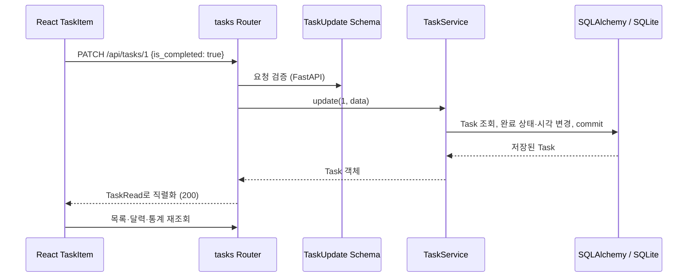

# Dayly / Personal Todo Management

FastAPI를 학습하며 실제로 사용할 수 있는 **로컬 단일 사용자 할 일 관리 MVP**입니다. 날짜별 할 일, 월간 달력, 최근 7일 기록과 달성률을 React 화면에서 관리합니다. 데이터는 실제 API와 SQLite에 저장하며, 샘플 데이터를 자동으로 넣지 않습니다.

## 기능

- 제목·설명·예정 날짜 생성/수정, 삭제, 완료 체크/해제
- 월 이동, 오늘/선택 날짜 강조, 날짜별 완료/전체 개수 표시
- 선택 날짜의 달성률 Progress Bar
- 최근 7일의 일일 달성률 막대그래프와 전체 할 일 기준 주간 달성률
- API 저장 성공 후 목록·달력·통계 재조회, 로딩/실패/재시도 처리
- 모바일 세로 배치, 키보드 조작과 접근성 레이블, 입력을 보존하는 폼

## 기술과 구조

Backend: Python 3.11+, FastAPI, Pydantic 2, SQLAlchemy 2.x, Alembic, SQLite, pytest.

Frontend: React 19, TypeScript, Vite, Tailwind CSS 4, Lucide 아이콘, Playwright. 달력과 차트는 이 규모에 맞게 직접 구현해 날짜 처리와 집계 흐름을 쉽게 읽을 수 있습니다.

```text
backend/
├── app/
│   ├── main.py                # 앱 조립, CORS, 예외 → HTTP 응답
│   ├── api/                   # Router와 Depends를 통한 주입
│   │   ├── dependencies.py
│   │   ├── tasks.py
│   │   └── statistics.py
│   ├── schemas/               # API 입출력 계약·검증
│   │   ├── task.py
│   │   └── statistics.py
│   ├── models/task.py         # DB 테이블과 제약조건
│   ├── services/              # 비즈니스 규칙·집계·트랜잭션
│   │   ├── tasks.py
│   │   ├── statistics.py
│   │   └── policy.py
│   ├── core/                  # 설정, UTC/서울 시계, 도메인 오류
│   └── db.py                  # Engine, Base, 요청별 Session
├── alembic/                   # 스키마 변경 이력
├── tests/                     # 실제 마이그레이션을 적용한 임시 SQLite 테스트
├── pyproject.toml
└── uv.lock
frontend/
├── src/
│   ├── App.tsx                # Dashboard 조립과 화면 선택 상태
│   ├── components/            # Calendar, TaskList, TaskItem, TaskForm,
│   │                          # DailyProgress, WeeklyStatistics
│   ├── hooks/useDashboard.ts  # 데이터 조회·갱신·취소
│   ├── lib/api.ts             # HTTP 호출과 오류 처리
│   ├── lib/dates.ts           # 서울 날짜·날짜 전용 연산
│   ├── types.ts               # API 응답 TypeScript 타입
│   └── styles.css
├── e2e/                       # 실제 백엔드와 통신하는 브라우저 테스트
└── package-lock.json
```

## 설치와 실행

개인용으로 계속 사용하려면 아래 Docker 실행을 권장합니다. 개발할 때는 이어지는 두 터미널 실행 방법을 사용하세요.

### Docker로 실행

Docker Desktop을 설치하고 실행한 뒤, `compose.yaml`이 있는 **프로젝트 루트**에서 실행합니다. Python·Node.js를 별도로 설치할 필요가 없습니다.

```bash
docker compose up -d --build --wait
```

접속: **http://localhost:8080** · API 문서: http://localhost:8080/docs

첫 실행은 이미지와 패키지를 다운로드하고 프론트엔드를 빌드하므로 시간이 걸립니다. 백엔드는 시작할 때 `alembic upgrade head`를 자동 실행하며, DB 준비가 확인된 뒤 프론트엔드가 시작합니다. `--wait`는 두 서비스가 정상 상태가 될 때까지 기다립니다.

나중에 다시 켜거나 끌 때도 루트에서 실행합니다.

```bash
# 다시 켜기 (기존 이미지 사용)
docker compose up -d --wait

# 종료 (할 일 데이터는 유지)
docker compose down

# 코드 변경 후 다시 빌드하고 실행
docker compose up -d --build --wait

# 실행 상태 / 오류 로그 확인
docker compose ps
docker compose logs -f
```

Docker Desktop이 실행 중일 때 앱이 동작합니다. 서비스는 `restart: unless-stopped`로 설정했으므로 직접 중지하지 않은 컨테이너는 Docker 엔진이 다시 시작될 때 함께 시작합니다. Mac 재부팅 후 자동으로 사용하려면 Docker Desktop의 로그인 시 시작 옵션도 켜 두세요.

**데이터 저장**

SQLite는 컨테이너 안의 `/app/data/todo.db`에 저장하고, 해당 디렉터리를 Docker의 `dayly_data` 볼륨에 연결합니다. 컨테이너 종료·재생성·이미지 재빌드 후에도 기록이 유지됩니다. **`docker compose down -v`는 볼륨과 기록까지 삭제하므로 일반 종료에는 사용하지 마세요.** 개발 서버의 `backend/data/todo.db`와는 별도 DB이며 기존 파일을 자동으로 가져오지는 않습니다.

실행 중인 DB를 일관된 상태로 백업하려면 SQLite의 backup 기능을 사용합니다. 프로젝트 루트에서 다음을 실행하면 `todo-backup.db`가 생깁니다. 같은 이름의 기존 백업이 있다면 먼저 다른 곳에 보관하세요.

```bash
docker compose exec -T backend python -c "import sqlite3; source = sqlite3.connect('/app/data/todo.db'); target = sqlite3.connect('/tmp/todo-backup.db'); source.backup(target); target.close(); source.close()"
docker compose cp backend:/tmp/todo-backup.db ./todo-backup.db
```

8080 포트를 이미 사용 중이면 프로젝트 루트의 `.env.example`을 `.env`로 복사하고 `DAYLY_PORT=8081`처럼 바꾼 뒤 다시 실행합니다. 환경변수로 한 번 지정할 수도 있습니다.

```bash
DAYLY_PORT=8081 docker compose up -d --wait
```

**Docker 구조와 선택 이유**

```text
브라우저 → localhost:8080 → Nginx (frontend)
                            ├── React 정적 빌드 제공
                            └── /api → FastAPI (backend) → SQLite 볼륨
```

- `compose.yaml`: 두 서비스, DB 볼륨, 자동 재시작, 준비 상태 검사를 정의합니다.
- `deploy/DockerFile`: 기존의 빈 파일을 Backend 이미지로 구성했습니다. `uv.lock`의 런타임 의존성만 설치하고 일반 사용자로 실행합니다.
- `deploy/start-backend.sh`: 마이그레이션 성공 후 Uvicorn을 실행합니다. 실패 시 서버를 시작하지 않습니다.
- `deploy/frontend.Dockerfile`: Node 단계에서 `npm ci`와 빌드를 수행하고 최종 Nginx 이미지에는 정적 산출물만 넣습니다.
- `deploy/nginx.conf`: 화면과 API를 같은 주소로 제공하므로 별도 API 주소·CORS 설정이 필요 없습니다. 컨테이너 교체 시 Docker DNS로 새 백엔드를 찾습니다.
- `.dockerignore`: 로컬 의존성, DB, `.env`와 테스트 산출물을 빌드에 포함하지 않습니다.

호스트에 공개하는 포트는 `127.0.0.1`의 웹 포트 하나이며 백엔드는 Docker 내부에서만 접근합니다. 현재의 인증 없는 개인용 사용 범위에 맞춘 설정입니다.

Docker 검증: 두 이미지 빌드와 서비스 healthcheck, Nginx 설정, API 프록시, 자동 마이그레이션, SQLite 백업을 확인했습니다. 별도 검증용 볼륨에 할 일을 저장한 뒤 `down`/`up`으로 컨테이너를 재생성해 필드·완료 시각이 유지되는지 검사했고, Chromium에서도 보존된 할 일과 100% 달성률 표시를 확인했습니다.

### 개발 서버로 실행

필요 도구: [uv](https://docs.astral.sh/uv/getting-started/installation/), Python 3.11 이상, Node.js 22.12 이상과 npm. 의존성 버전은 `uv.lock`, `package-lock.json`에 고정합니다.

**터미널 1 — Backend**

```bash
cd backend
uv sync --locked
cp .env.example .env
uv run alembic upgrade head
uv run uvicorn app.main:app --reload --host 127.0.0.1 --port 8000
```

- API: http://127.0.0.1:8000/api/tasks?date=2026-11-02 (날짜는 조회할 날짜로 변경)
- Swagger UI: http://127.0.0.1:8000/docs
- 기본 DB: `backend/data/todo.db` — 실행 위치와 관계없이 같은 파일을 사용합니다.
- 테이블은 **Alembic으로 생성**합니다. 앱 실행 시 `create_all()`을 호출하지 않아 마이그레이션 누락을 숨기지 않습니다.

**터미널 2 — Frontend**

```bash
cd frontend
npm ci
npm run dev
```

http://127.0.0.1:5173 에 접속합니다. Vite가 `/api` 요청을 `127.0.0.1:8000`으로 전달합니다. 두 서버를 함께 실행해야 합니다.

**환경 설정**

`backend/.env`의 `DATABASE_URL`, `CORS_ORIGINS`를 변경할 수 있습니다. `CORS_ORIGINS`는 JSON 배열입니다. 기본적으로 localhost/127.0.0.1의 5173 포트만 허용합니다. 환경변수는 `.env`보다 우선합니다.

프론트엔드는 필요할 때 `frontend/.env.example`을 `.env`로 복사하고 `VITE_API_BASE_URL=http://127.0.0.1:8000`을 설정합니다. 값에는 `/api`를 붙이지 않습니다. 기본 개발 설정에서는 파일을 만들 필요가 없습니다. Vite의 프록시 대상만 바꾸려면 `API_PROXY_TARGET`을 사용합니다.

PostgreSQL 전환 시에는 드라이버(예: psycopg)를 설치하고 `DATABASE_URL=postgresql+psycopg://...`를 설정한 뒤 대상 DB에 마이그레이션을 적용합니다. 기존 SQLite 데이터의 이관은 별도 작업이며 이 MVP에 포함하지 않습니다.

## FastAPI 핵심 개념과 설계 이유

| 계층 | 책임 | 이 프로젝트에서 하지 않는 일 |
|---|---|---|
| **Router** (`app/api`) | HTTP 경로·상태 코드·쿼리 정의, 서비스 호출, 응답 Schema 지정 | SQL 작성, 달성률 계산 |
| **Pydantic Schema** (`app/schemas`) | JSON 요청 검증과 응답 직렬화. 제목 trim/길이, ISO 날짜, PATCH 필드 검증 | DB 테이블 생성, 저장 |
| **SQLAlchemy Model** (`app/models`) | Python 객체와 DB 행 매핑, 컬럼·인덱스·무결성 제약 정의 | 요청 검증, HTTP 응답 반환 |
| **Service** (`app/services`) | 조회 기간, 완료 시각, CRUD 트랜잭션, 달성률 계산 | FastAPI Request/Response 사용 |
| **DB/Configuration** | Engine 연결, 요청별 Session 수명, 환경변수 로딩 | 화면 상태 관리 |

Schema와 Model을 분리하면 클라이언트가 `id`, `created_at`, `completed_at` 같은 서버 관리 필드를 임의 변경할 수 없습니다. 생성·수정·응답 Schema도 각각 분리했습니다. `extra="forbid"`로 정의하지 않은 입력 필드를 거절합니다.

예를 들어 완료 체크의 흐름은 다음과 같습니다.



- **`APIRouter`**: 기능별 경로를 모아 `main.py`의 `include_router()`로 연결합니다. 앱 설정과 개별 엔드포인트를 분리합니다.
- **`Depends`**: Session과 서울 기준 오늘을 서비스에 주입합니다. 테스트에서는 `dependency_overrides`로 임시 DB와 고정 날짜를 주입합니다.
- **`response_model`**: ORM 객체를 `TaskRead`로 변환하고 외부에 제공할 필드와 OpenAPI 문서를 명확히 합니다. `from_attributes=True`가 ORM 속성 읽기를 허용합니다.
- **동기 Router + 동기 Session**: 이 작은 SQLite 앱에서는 구성이 단순한 동기 ORM을 선택했습니다. FastAPI의 동기 엔드포인트 실행 방식에 맞췄으며, 하나의 Session을 요청 간 공유하지 않습니다.
- **Service가 쓰기 트랜잭션 소유**: 규칙 확인과 상태 변경을 한 번의 commit으로 저장합니다. 실패하면 Session 의존성이 rollback하고 종료합니다. 별도 Repository 계층은 현재 규모에 불필요한 간접화를 만들므로 추가하지 않았습니다.
- **도메인 오류와 HTTP 분리**: Service의 `DomainError`를 `main.py`에서 403/404로 변환합니다. Service를 HTTP 없이 테스트하거나 다른 호출자에서 재사용할 수 있습니다.

공식 참고: [FastAPI APIRouter](https://fastapi.tiangolo.com/tutorial/bigger-applications/), [SQLAlchemy Session](https://docs.sqlalchemy.org/en/20/orm/session_basics.html).

## 날짜·통계·상태 정책

- `scheduled_date`는 시간대가 없는 `YYYY-MM-DD` 날짜입니다. `created_at`, `updated_at`, `completed_at`은 UTC로 저장하고 UTC 오프셋이 있는 ISO 8601 문자열로 반환합니다. SQLite의 시간대 메타데이터 손실은 `UTCDateTime` 타입이 복원합니다.
- ‘오늘’은 백엔드 `Asia/Seoul` 기준입니다. 프론트엔드도 같은 기준을 사용하고 30초마다 날짜 변경을 확인합니다. 기기의 로컬 시간대로 날짜가 밀리지 않도록 날짜 전용 연산은 UTC를 사용합니다.
- 최근 7일 범위는 **오늘−6일 ≤ 예정 날짜 ≤ 오늘**입니다. 미래 일정은 상세 조회·관리가 가능합니다.
- 오래된 데이터는 보존하고 월간 달력에는 완료/전체 집계를 제공합니다. 상세 조회와 일일 통계는 403입니다. 제한을 우회해 과거 상세를 반환하지 않도록 오래된 항목의 수정·삭제와 그 날짜로의 생성·이동도 제한하는 정책을 선택했습니다.
- 일일 달성률 = 완료 / 전체 × 100. 주간 달성률 = 7일간 완료 합계 / 전체 합계 × 100. **일별 비율의 평균을 사용하지 않습니다.**
- 할 일이 없으면 비율은 `null`이며 UI는 ‘기록 없음’으로 표시합니다. 할 일이 있지만 모두 미완료라면 `0`입니다. API는 소수 둘째 자리까지 계산하고 UI는 정수 반올림으로 표시합니다.
- 완료 체크 시 UTC 시각을 기록하고 해제 시 `null`로 지웁니다. 반복된 완료 요청은 최초 완료 시각을 유지합니다. DB 제약도 상태와 완료 시각의 일관성을 보장합니다.
- 통계는 예정 날짜 기준으로 SQL 집계합니다. 별도 캐시 없이 현재 DB 상태를 사용하므로 생성·삭제·날짜 이동 후에도 계산이 일치합니다.
- UI는 서버 저장이 성공한 뒤 다시 조회합니다. 저장 실패 시 완료 표시를 먼저 바꾸지 않으며, 폼 입력을 보존합니다. 날짜를 빠르게 바꾸면 이전 조회를 취소해 늦은 응답이 다른 날짜에 표시되는 것을 방지합니다. 재조회 자체가 실패하면 오류와 재시도 버튼을 표시합니다.

## 주요 API

| Method | Endpoint | 입력/결과 |
|---|---|---|
| GET | `/api/tasks?date=YYYY-MM-DD` | 날짜별 할 일 배열 |
| POST | `/api/tasks` | `title`, `scheduled_date`, 선택 `description` → 201 |
| PATCH | `/api/tasks/{id}` | 제목·설명·날짜·`is_completed` 중 변경할 필드 → 200 |
| DELETE | `/api/tasks/{id}` | 삭제 → 204, 본문 없음 |
| GET | `/api/calendar?year=2026&month=11` | 모든 날짜의 완료/전체/미완료 개수·비율 |
| GET | `/api/stats/daily?date=YYYY-MM-DD` | 해당 날짜의 개수·달성률 |
| GET | `/api/stats/weekly` | 최근 7일 일별 기록과 가중 달성률 |

잘못된 입력은 422, 없는 항목은 404, 과거 상세 제한은 403, 저장소 오류는 503입니다. 도메인 오류는 `{"code":"...","detail":"..."}` 형식, 입력 검증 오류는 FastAPI 기본 `detail` 배열 형식입니다.

PATCH에서 생략한 필드는 유지됩니다. `description: null`은 설명을 지우고, 제목·날짜·완료 상태의 명시적 `null`과 빈 PATCH는 거절합니다.

## 테스트와 빌드

**Backend**

```bash
cd backend
uv run pytest -q
uv run alembic check
```

pytest는 테스트마다 임시 SQLite 파일에 실제 Alembic 마이그레이션을 적용합니다. 개인 DB를 초기화하지 않습니다. CRUD, 저장 지속성, 입력 오류, 완료 시각, 통계 변경, 가중 비율, 7일 경계, 과거 제한/보존, 미래 날짜, 윤년, 서울 자정, DB 제약과 마이그레이션 왕복을 검사합니다. `alembic check`는 먼저 `alembic upgrade head`를 실행한 개발 DB에서 모델과 마이그레이션 차이를 확인합니다.

**Frontend**

```bash
cd frontend
npm run build
npx playwright install chromium
npm run test:e2e
```

빌드는 엄격한 TypeScript 검사 후 `dist/`를 생성합니다. Playwright는 **별도의 임시 DB**, 백엔드 8001 포트, 프론트엔드 5174 포트를 사용합니다. 두 테스트용 포트는 비어 있어야 합니다. 기본 브라우저 테스트는 실제 API로 생성·완료/해제·새로고침·수정·날짜 이동·삭제를 검증하며, 저장/조회 실패, 기간 제한, 모바일 가로 넘침도 확인합니다. 스크린샷과 실패 trace는 `frontend/test-results/`에 생성합니다.

구현 검증 결과: **pytest 37개 통과, Playwright 4개 통과, TypeScript/Vite 빌드 성공, `alembic check` 차이 없음**. 브라우저에서도 실제 10개 중 7개 완료 시 일일·주간 70% 표시와 완료 저장 실패 시 기존 상태 유지를 확인했습니다.

## 범위와 제약

로컬 단일 사용자용이며 인증, 다중 사용자 권한, 반복 일정, 알림, 외부 배포는 포함하지 않습니다. 기본 서버는 loopback에만 바인딩합니다. 공개 인터넷에 배포하려면 먼저 인증·접근 제어를 구현해야 하며, 인증 없이 개인 데이터 API를 공개하면 안 됩니다. CORS는 인증을 대신하지 않습니다.

공개 인터넷 배포 구성과 PostgreSQL의 실제 운영 검증은 포함하지 않습니다. 실행 방법은 위의 Docker Compose 또는 두 개발 서버 방식입니다. 프론트엔드 빌드 결과만 열어서는 API가 제공되지 않습니다.
